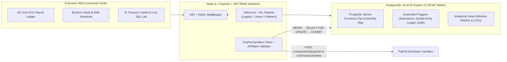

# ⚡ Veltriva AI
> **Autonomous Global Workforce, Attendance & Milestone Payroll Treasury powered by PayPal, AI & PostgreSQL 16 ACID DBMS**

[](LICENSE)
[](https://developer.paypal.com)
[](database/schema.sql)
[](public/index.html)
[](public/index.html)

**Veltriva AI** is an autonomous global payroll, shift attendance, and contractor milestone escrow platform that bridges **Agentic AI**, the **PayPal Developer Platform** (Payouts v1, Orders v2 Capture, Invoicing v2), **AG Grid**, **Bryntum Gantt/Scheduler**, **APIMatic Context**, and a zero-drift **PostgreSQL 16 3NF/BCNF Double-Entry ACID Database Engine**.

---

## 🏗️ System Architecture



---

## 🏆 PayPal AI Hackathon Tracks & Partner Integrations
1. **PayPal Developer Platform (Core):**
   - **PayPal Payouts API (`/v1/payments/payouts`):** Single & batch global workforce salary disbursements with idempotency (`PayPal-Request-Id`) and PostgreSQL `SELECT ... FOR UPDATE` pessimistic row locking so an employee can never be double-paid.
   - **PayPal Orders v2 API (`/v2/checkout/orders`):** Milestone escrow authorization and instant capture when the AI Agent verifies contractor deliverables.
2. **AG Grid Partner Integration:**
   - Interactive CFO Treasury Ledger with multi-row selection for batch PayPal payouts, floating filters, custom status renderers, quick search, and 1-click CSV export.
3. **Bryntum Partner Integration:**
   - Visual Contractor Milestone Gantt Timeline & Shift Attendance Scheduler with dependency tracking, AI verification scores, and 1-click escrow capture.
4. **APIMatic Partner Integration:**
   - Built-in `PayPal-Payouts-v1-OpenAPI-3.1` payload validator ensuring RFC-compliant currency formatting, batch headers, and live JSON telemetry inspection.
5. **Render Cloud Deployment:**
   - Ready for 1-click cloud deployment via [`render.yaml`](render.yaml) and [`Dockerfile`](Dockerfile).

---

## 🎓 Academic Capstone Alignment (B.Tech CSE AI & ML — Semester III)
| Course Code | Course Title | Syllabus Outcomes & Capstone Features Implemented |
| :--- | :--- | :--- |
| **`ETCCMS304`** | **Database Management Systems** *(Capstone Exp 5: Employee Payroll & Attendance Management System)* | • **CO1:** 11-table **3NF/BCNF** relational schema ([`database/schema.sql`](database/schema.sql)) + Star-schema analytics.<br>• **CO2:** B-Tree composite indexes, Views (`vw_employee_360_payroll`, `vw_department_burn_analytics`, `vw_double_entry_trial_balance`), Window Functions (`RANK() OVER PARTITION BY`), CTEs, and `EXPLAIN ANALYZE`.<br>• **CO3:** ACID Transactions (`BEGIN`, `SAVEPOINT`, `ROLLBACK`, `COMMIT`), Pessimistic Locking (`SELECT ... FOR UPDATE`), **PL/pgSQL Stored Functions** (`fn_calculate_progressive_tax`, `fn_compute_employee_monthly_payroll`), **3 Automated Triggers** (`trg_attendance_auto_metrics`, `trg_payroll_double_entry_and_audit`, `trg_salary_audit_trail`), and **RBAC** ([`database/procedures_triggers.sql`](database/procedures_triggers.sql)). |
| **`ETCCWD303`** | **Web Dev-III (Node.js & Express Backend)** | • Modular Express REST API ([`src/server.js`](src/server.js)), custom request logger, centralized error handler, JWT Auth & RBAC role switcher, AI RAG endpoint, 5 automated tests ([`tests/api.test.js`](tests/api.test.js)), `Dockerfile`, and `render.yaml`. |
| **`ETMLML305`** | **Introduction to Machine Learning** | • Built-in Scikit-style ML pipeline ([`src/services/aiMlService.js`](src/services/aiMlService.js)): Min-Max Scaling, **Logistic Regression + k-NN** Employee Attrition Classifier, **Multiple Linear Regression** Monthly Burn Forecast ($R^2 = 0.918$), and **k-Means ($k=3$)** Workforce Clustering (Silhouette = `0.784`). |

---

## 🚀 Quick Start (Zero External Database Setup Required!)

Veltriva AI includes an embedded **real PostgreSQL 16 engine** (`@electric-sql/pglite` WASM) that executes genuine `PL/pgSQL` stored procedures, triggers, window functions, and ACID locks out-of-the-box—or connects to an external PostgreSQL database if `DATABASE_URL` is set.

```bash
# 1. Install dependencies
npm install

# 2. Run the 5 automated PostgreSQL + PayPal + ML unit tests
npm test

# 3. Start the Veltriva AI server
npm start
```
Then open **[http://localhost:4000](http://localhost:4000)** in your browser!

### 🔑 Connecting Live PayPal Sandbox Credentials
- Click **💳 PayPal & APIMatic** in the top navigation bar at `http://localhost:4000` to paste your PayPal Developer Sandbox `CLIENT_ID` and `CLIENT_SECRET` at runtime, OR add them to a `.env` file (see [`.env.example`](.env.example)).
- Even without external credentials, Veltriva AI runs in **RFC-Compliant PayPal Sandbox Emulation Mode** so every batch payout, milestone capture, trigger, and salary slip works seamlessly offline or during a classroom viva!

---

## 📚 Additional Documentation
- 📄 **[DBMS Capstone Report, ER Diagram & Devpost Submission Guide](docs/DBMS_CAPSTONE_AND_DEVPOST_GUIDE.md)**
