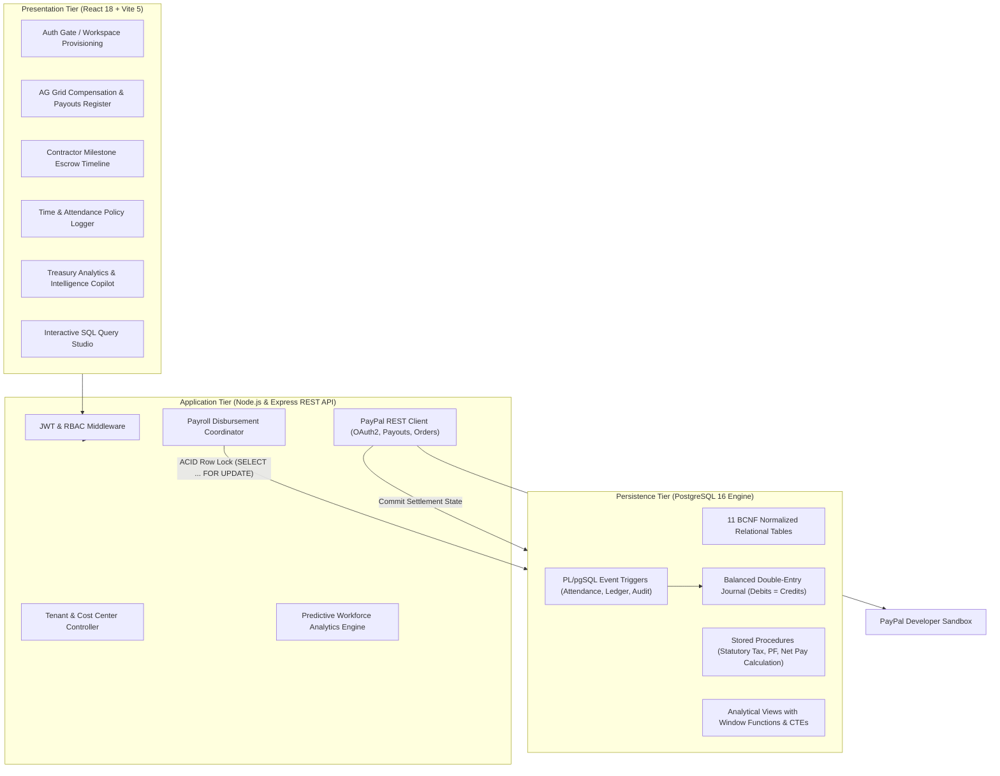

# Veltriva

> **Enterprise Workforce Treasury, Milestone Escrow & Payroll OS**

[](LICENSE)
[](https://nodejs.org)
[](https://vitejs.dev)
[](https://www.postgresql.org)
[](https://developer.paypal.com)

Veltriva is an enterprise-grade global workforce payroll, attendance policy, and contractor milestone escrow treasury platform. It unifies multi-tenant workforce management, automated statutory deductions, milestone verification, and disbursement execution backed by a strict PostgreSQL 16 double-entry ACID ledger and the PayPal Developer Platform.

---

## Architectural Overview

Veltriva is designed around strict separation of concerns, transactional integrity, and multi-tenant data isolation:



---

## Key Features

### 1. Multi-Tenant Workspace Isolation
- **Organization-Level Partitioning:** Every entity (employees, departments, milestones, payroll runs, ledger journals, and audit records) is strictly scoped to an `org_id` in the `organizations` table.
- **Isolated Gateway Credentials:** Each organization maintains its own encrypted PayPal Client ID and Secret. Custom workspaces never share or inherit host environment keys.
- **Zero-Key Sandbox Emulator:** Workspaces without configured external PayPal developer credentials automatically fall back to an RFC-compliant sandbox simulation mode with complete transactional ledger tracking.

### 2. Automated Policy Enforcement & Stored Functions
- **Automated Net Pay Computation:** The stored function `fn_compute_employee_monthly_payroll()` computes gross compensation, late arrival deductions, unpaid leave (loss of pay) deductions, progressive income tax withholding, and retirement fund contributions directly inside PostgreSQL.
- **Statutory Tax Slabs:** Progressive multi-tier tax brackets are maintained across jurisdictions (United States, India, United Kingdom, Singapore, Germany) in the `tax_slabs` table.
- **Event-Driven Triggers:** Shift logs captured via the attendance portal automatically trigger `trg_attendance_auto_metrics`, marking policy infractions (arrivals after 09:15) and calculating overtime thresholds before recalculating net payout.

### 3. Concurrency Protection & Transaction Protocol
- **Pessimistic Row-Level Locking:** Disbursement routines execute within transactional boundaries (`BEGIN` &rarr; `SAVEPOINT` &rarr; `SELECT ... FOR UPDATE` &rarr; `COMMIT`), preventing double-payment race conditions across concurrent administrative sessions.
- **Idempotency Enforcement:** Outbound PayPal batch requests generate unique, cryptographically random `PayPal-Request-Id` headers matched against the internal transaction state.

### 4. Double-Entry General Ledger & Immutable Audit Trail
- **Real-Time Journal Balancing:** Every completed payout or escrow capture fires `trg_payroll_double_entry_and_audit`, recording double-entry entries in the `double_entry_ledger` table such that:
  $$\sum \text{Debits} = \sum \text{Credits}$$
- **Audit Logging:** Structural modifications to salaries and payment settlements generate structured JSONB before-and-after snapshots in the `audit_logs` table.

### 5. Contractor Milestone Escrow & Deliverable Tracking
- **Milestone Timeline:** Interactive timeline tracking contractor deliverables, verification ratings, and escrow capital allocations.
- **PayPal Orders v2 Capture:** Escrowed capital is captured through PayPal Orders v2 upon deliverable approval, immediately posting corresponding debit and credit entries to the general ledger.

### 6. Workforce Analytics & Machine Learning Pipeline
- **Employee Attrition Classifier:** Scikit-style Logistic Regression combined with k-Nearest Neighbors ($k$-NN) providing attrition probability scoring.
- **Monthly Treasury Burn Forecast:** Multiple Linear Regression model forecasting next-cycle gross workforce commitments.
- **Unsupervised Segmentation:** $k$-Means clustering ($k=3$) categorizing personnel by compensation, overtime, and policy compliance features.

---

## Technology Stack

| Layer | Technologies |
| :--- | :--- |
| **Frontend** | React 18, Vite 5, AG Grid Community/React, Lucide Icons |
| **Backend** | Node.js (v20+ / v22 LTS), Express 4, JSON Web Tokens, Bcrypt.js |
| **Database** | PostgreSQL 16 (Relational BCNF), PGlite WASM (local in-memory fallback), PL/pgSQL |
| **Payments** | PayPal Developer Platform (REST OAuth2, Payouts API v1, Orders API v2) |
| **Intelligence** | Google Gemini API (`gemini-3.5-flash-lite`), In-App Mathematical ML Pipeline |
| **DevOps** | Docker, Render Blueprint (`render.yaml`), Node Test Runner |

---

## Database Architecture

The persistence model consists of 11 Boyce-Codd Normal Form (BCNF) tables designed to avoid data redundancy and update anomalies:

```
organizations (Tenant roots & gateway credentials)
 ├── departments (Cost centers & operational budgets)
 ├── roles_permissions (RBAC matrix)
 └── employees (Personnel directory)
      ├── salary_structures (Compensation components)
      ├── attendance_logs (Shift records & policy flags)
      ├── leave_requests (Absence allocations)
      ├── contractor_milestones (Project deliverables & escrow)
      └── payroll_runs (Monthly compensation snapshots)
           └── double_entry_ledger (Debits & credits journal)
```

Detailed relational schemas, Boyce-Codd Normal Form proofs, and database trigger specifications are documented in **[docs/ARCHITECTURE_AND_SCHEMA.md](docs/ARCHITECTURE_AND_SCHEMA.md)**.

---

## Getting Started

### Prerequisites
- **Node.js** (v20.x or v22.x LTS recommended)
- **npm** (v10.x or higher)
- **PostgreSQL** (Optional: Veltriva includes an embedded PostgreSQL 16 WASM engine for local zero-dependency testing, or connects to any cloud PostgreSQL instance via `DATABASE_URL`)

### Installation

```bash
# Clone the repository
git clone https://github.com/Programmer-Develops/veltriva-ai.git
cd veltriva-ai

# Install dependencies
npm install

# Build the React + Vite production bundle
npm run build
```

### Environment Configuration

Create a `.env` file in the project root (reference [`.env.example`](.env.example)):

```ini
PORT=4000
NODE_ENV=production
JWT_SECRET=your_secure_jwt_secret_key

# Optional: Cloud PostgreSQL database (leave blank to use embedded engine)
DATABASE_URL=

# Optional: PayPal Developer Sandbox credentials (leave blank for Sandbox Emulator)
PAYPAL_MODE=sandbox
PAYPAL_CLIENT_ID=
PAYPAL_CLIENT_SECRET=

# Optional: Google Gemini API key for natural language SQL Copilot
GEMINI_API_KEY=
```

### Running the Application

```bash
# Run unit and integration tests
npm test

# Start the unified production server (serves API & Vite frontend on port 4000)
npm start

# For frontend development with Hot Module Replacement (HMR):
npm run dev:client
```

Access the web interface at **`http://localhost:4000`**.

---

## Automated Verification

The test suite covers database initialization, trigger execution, double-entry mathematical reconciliation, PayPal payload schema formatting, ML scoring, and multi-tenant isolation:

```bash
npm test
```

Test coverage includes:
1. PostgreSQL 16 BCNF Schema & Seed Data Initialization
2. `PL/pgSQL` Trigger `trg_attendance_auto_metrics` & Recalculation
3. Double-Entry General Ledger Balance Validation ($\sum \text{Debits} = \sum \text{Credits}$)
4. PayPal Payouts Schema & Batch Formatting
5. Workforce Machine Learning Pipeline Execution
6. Multi-Tenant Workspace Row-Level Isolation

---

## Deployment

### Docker

Build and run using the provided container configuration:

```bash
docker build -t veltriva-ai .
docker run -p 4000:4000 --env-file .env veltriva-ai
```

### Render

A declarative Infrastructure-as-Code Blueprint is provided in [`render.yaml`](render.yaml):
1. Connect the repository in the **Render Dashboard**.
2. Select **New + &rarr; Blueprint**.
3. Configure the environment variables (`DATABASE_URL`, `PAYPAL_CLIENT_ID`, `PAYPAL_CLIENT_SECRET`, `GEMINI_API_KEY`).
4. Deploy the service. Health checks are handled automatically via `/api/health`.

---

## License

This project is licensed under the MIT License — see the [LICENSE](LICENSE) file for details.
