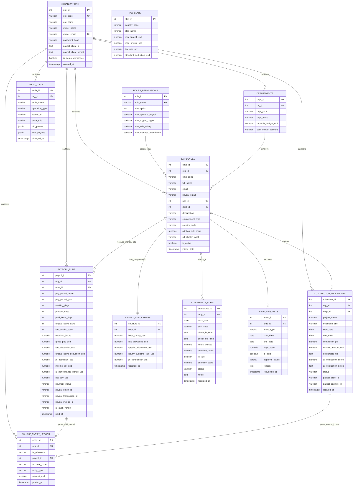

# System Architecture & Database Specification

This document provides the technical architecture, relational schema definition, normalization proofs, and stored procedure specifications for the **Veltriva** platform.

---

## 1. Entity-Relationship (ER) Diagram



---

## 2. DBML Schema Specification

```dbml
Table organizations {
  org_id int [pk, increment]
  org_code varchar [unique, not null]
  org_name varchar [not null]
  owner_name varchar [not null]
  owner_email varchar [unique, not null]
  password_hash varchar [not null]
  base_currency varchar [default: 'USD']
  paypal_client_id text
  paypal_client_secret text
  is_demo_workspace boolean [default: false]
  created_at timestamp [default: `CURRENT_TIMESTAMP`]
}

Table roles_permissions {
  role_id int [pk, increment]
  role_name varchar [unique, not null]
  description text [not null]
  can_approve_payroll boolean [default: false]
  can_trigger_paypal boolean [default: false]
  can_edit_salary boolean [default: false]
  can_manage_attendance boolean [default: false]
}

Table departments {
  dept_id int [pk, increment]
  org_id int [ref: > organizations.org_id]
  dept_code varchar [not null]
  dept_name varchar [not null]
  monthly_budget_usd numeric(12,2) [not null]
  cost_center_account varchar [not null]
}

Table tax_slabs {
  slab_id int [pk, increment]
  country_code varchar(4) [not null]
  slab_name varchar(60) [not null]
  min_annual_usd numeric(12,2) [not null]
  max_annual_usd numeric(12,2)
  tax_rate_pct numeric(5,2) [not null]
  standard_deduction_usd numeric(10,2) [default: 0.00]
}

Table employees {
  emp_id int [pk, increment]
  org_id int [ref: > organizations.org_id]
  emp_code varchar(20) [not null]
  full_name varchar(100) [not null]
  email varchar(120) [not null]
  paypal_email varchar(120) [not null]
  role_id int [ref: > roles_permissions.role_id]
  dept_id int [ref: > departments.dept_id]
  designation varchar(80) [not null]
  employment_type varchar(20) [not null]
  country_code varchar(4) [not null]
  attrition_risk_score numeric(5,2) [default: 15.00]
  ml_cluster_label varchar(32) [default: 'STABLE_CORE']
  is_active boolean [default: true]
  joined_date date [default: `CURRENT_DATE`]
}

Table salary_structures {
  structure_id int [pk, increment]
  emp_id int [unique, ref: - employees.emp_id]
  base_salary_usd numeric(10,2) [not null]
  hra_allowance_usd numeric(10,2) [default: 0.00]
  special_allowance_usd numeric(10,2) [default: 0.00]
  hourly_overtime_rate_usd numeric(8,2) [default: 50.00]
  pf_contribution_pct numeric(5,2) [default: 12.00]
  updated_at timestamp [default: `CURRENT_TIMESTAMP`]
}

Table attendance_logs {
  attendance_id int [pk, increment]
  emp_id int [ref: > employees.emp_id]
  work_date date [not null]
  shift_code varchar(20) [default: 'SHIFT_MORNING']
  check_in_time time [not null]
  check_out_time time [not null]
  hours_worked numeric(4,2)
  overtime_hours numeric(4,2) [default: 0.00]
  is_late boolean [default: false]
  anomaly_score numeric(5,2) [default: 0.00]
  status varchar(20) [default: 'PRESENT']
  notes text
  recorded_at timestamp [default: `CURRENT_TIMESTAMP`]
}

Table leave_requests {
  leave_id int [pk, increment]
  emp_id int [ref: > employees.emp_id]
  leave_type varchar(20) [not null]
  start_date date [not null]
  end_date date [not null]
  days_count int [not null]
  is_paid boolean [default: true]
  approval_status varchar(20) [default: 'PENDING']
  reason text
  requested_at timestamp [default: `CURRENT_TIMESTAMP`]
}

Table contractor_milestones {
  milestone_id int [pk, increment]
  org_id int [ref: > organizations.org_id]
  emp_id int [ref: > employees.emp_id]
  project_name varchar(100) [not null]
  milestone_title varchar(140) [not null]
  start_date date [not null]
  due_date date [not null]
  completion_pct int [default: 0]
  escrow_amount_usd numeric(10,2) [not null]
  deliverable_url text
  ai_verification_score numeric(5,2) [default: 0.00]
  ai_verification_notes text
  status varchar(30) [default: 'PENDING_DELIVERY']
  paypal_order_id varchar(80)
  paypal_capture_id varchar(80)
  created_at timestamp [default: `CURRENT_TIMESTAMP`]
}

Table payroll_runs {
  payroll_id int [pk, increment]
  org_id int [ref: > organizations.org_id]
  emp_id int [ref: > employees.emp_id]
  pay_period_month int [not null]
  pay_period_year int [not null]
  working_days int [default: 22]
  present_days int [default: 22]
  paid_leave_days int [default: 0]
  unpaid_leave_days int [default: 0]
  late_marks_count int [default: 0]
  overtime_hours numeric(5,2) [default: 0.00]
  gross_pay_usd numeric(10,2) [not null]
  late_deduction_usd numeric(10,2) [default: 0.00]
  unpaid_leave_deduction_usd numeric(10,2) [default: 0.00]
  pf_deduction_usd numeric(10,2) [default: 0.00]
  income_tax_usd numeric(10,2) [default: 0.00]
  ai_performance_bonus_usd numeric(10,2) [default: 0.00]
  net_pay_usd numeric(10,2) [not null]
  payment_status varchar(20) [default: 'QUEUED']
  paypal_batch_id varchar(64)
  paypal_transaction_id varchar(64)
  paypal_invoice_id varchar(64)
  ai_audit_verdict varchar(40) [default: 'CLEAN_VERIFIED']
  paid_at timestamp
}

Table double_entry_ledger {
  entry_id int [pk, increment]
  org_id int [ref: > organizations.org_id]
  tx_reference varchar(80) [not null]
  payroll_id int [ref: > payroll_runs.payroll_id]
  account_code varchar(32) [not null]
  entry_type varchar(10) [not null]
  amount_usd numeric(12,2) [not null]
  posted_at timestamp [default: `CURRENT_TIMESTAMP`]
}

Table audit_logs {
  audit_id int [pk, increment]
  org_id int [ref: > organizations.org_id]
  table_name varchar(60) [not null]
  operation_type varchar(60) [not null]
  record_id varchar(40) [not null]
  actor_role varchar(40) [default: 'SYSTEM_TRIGGER']
  old_payload jsonb
  new_payload jsonb
  changed_at timestamp [default: `CURRENT_TIMESTAMP`]
}
```

---

## 3. Relational Normalization Analysis (1NF through BCNF)

The schema satisfies Boyce-Codd Normal Form (BCNF), ensuring that for every non-trivial functional dependency $X \rightarrow Y$, $X$ is a superkey:

### First Normal Form (1NF)
- All attribute values are atomic (e.g., compensation details, check-in timestamps, and tax slabs are isolated into distinct scalar columns).
- There are no repeating groups or variable-length arrays. Primary keys are explicitly defined for each entity.

### Second Normal Form (2NF)
- All tables in 1NF where non-prime attributes are fully functionally dependent on the entire primary key.
- Composite-keyed lookup tables (e.g., attendance records uniquely identified by composite candidate keys `(emp_id, work_date)`) contain no partial functional dependencies.

### Third Normal Form (3NF)
- Transitive dependencies are eliminated. Compensation logic is decoupled from employee identification:
  - `employees` contains identity, department, role, and country code.
  - `salary_structures` isolates base pay, allowances, overtime rates, and retirement contributions ($emp\_id \rightarrow structure\_id$).
  - `tax_slabs` establishes jurisdictional progressive rates keyed by `(country_code, slab_id)`. Employee compensation references tax slabs through parameterized SQL calculations rather than duplicating tax rules per employee record.

### Boyce-Codd Normal Form (BCNF)
- In every functional dependency $X \rightarrow Y$:
  - `organizations`: $org\_id \rightarrow (org\_code, org\_name, owner\_email, ...)$ where $org\_id$ and $owner\_email$ are candidate keys.
  - `roles_permissions`: $role\_id \rightarrow (role\_name, permissions)$ where $role\_id$ and $role\_name$ are candidate keys.
  - `salary_structures`: $emp\_id$ is unique, making it a candidate key for all salary component attributes.
  - `payroll_runs`: $payroll\_id$ and candidate composite key $(emp\_id, pay\_period\_month, pay\_period\_year)$ are candidate superkeys.

---

## 4. Stored Procedures and Triggers Specification

### 4.1 Attendance Metrics & Anomaly Detection Trigger
- **Trigger Name:** `trg_attendance_auto_metrics`
- **Table:** `attendance_logs`
- **Timing:** `BEFORE INSERT OR UPDATE`
- **Function:** `trg_fn_attendance_metrics()`
- **Logic:**
  1. Computes total working duration: $\text{hours\_worked} = \text{EXTRACT(EPOCH FROM (check\_out - check\_in))} / 3600$.
  2. Evaluates late-arrival policy: Checks if $\text{check\_in\_time} > \text{'09:15:00'}$. Sets `is_late = TRUE`.
  3. Computes overtime: If $\text{hours\_worked} > 8.0$, sets $\text{overtime\_hours} = \text{hours\_worked} - 8.0$.
  4. Flags single-day overtime anomalies ($\text{overtime\_hours} > 4.0$) with elevated `anomaly_score`.

### 4.2 Progressive Tax & Net Payroll Computation Function
- **Function Name:** `fn_compute_employee_monthly_payroll(p_emp_id, p_month, p_year, p_bonus)`
- **Returns:** `payroll_runs.payroll_id`
- **Logic:**
  1. Reads compensation components from `salary_structures`.
  2. Aggregates monthly attendance metrics: counts working days, present days, late check-ins, and overtime hours from `attendance_logs`.
  3. Evaluates absence impacts: aggregates unpaid leave days (`UNPAID_LWP`) from `leave_requests`.
  4. Applies late-arrival penalties: every 3 late marks apply a 0.5-day salary deduction.
  5. Computes gross compensation:
     $$\text{Gross Pay} = \text{Base} + \text{HRA} + \text{Special Allowance} + (\text{Overtime Hours} \times \text{Overtime Rate}) + \text{Bonus}$$
  6. Evaluates country-specific progressive tax brackets from `tax_slabs` via `fn_calculate_progressive_tax()`.
  7. Computes Provident Fund withholding: $\text{PF} = \text{Base Salary} \times \text{pf\_contribution\_pct}$.
  8. Derives final net disbursement:
     $$\text{Net Pay} = \text{Gross Pay} - \text{Late Deductions} - \text{Unpaid Leave Deductions} - \text{Income Tax} - \text{PF}$$
  9. Upserts the record into `payroll_runs`.

### 4.3 Double-Entry General Ledger Settlement Trigger
- **Trigger Name:** `trg_payroll_double_entry_and_audit`
- **Table:** `payroll_runs`
- **Timing:** `AFTER UPDATE`
- **Function:** `trg_fn_payroll_double_entry_and_audit()`
- **Condition:** Executed when `NEW.payment_status = 'COMPLETED'` and `OLD.payment_status != 'COMPLETED'`.
- **Accounting Postings:**
  - **DEBIT:** `5100_SALARIES_AND_WAGES_EXPENSE` ($\text{Amount} = \text{Gross Pay}$)
  - **CREDIT:** `1010_PAYPAL_TREASURY_VAULT` ($\text{Amount} = \text{Net Pay}$)
  - **CREDIT:** `2100_INCOME_TAX_WITHHOLDING_PAYABLE` ($\text{Amount} = \text{Income Tax}$)
  - **CREDIT:** `2150_PROVIDENT_FUND_TRUST_PAYABLE` ($\text{Amount} = \text{PF Withholding}$)
  - Total Debits strictly equal Total Credits.
- **Audit Snapshot:** Writes a structured JSONB payload of the previous and new payroll run state to `audit_logs`.

### 4.4 Salary Modification Audit Trail
- **Trigger Name:** `trg_salary_audit_trail`
- **Table:** `salary_structures`
- **Timing:** `AFTER UPDATE`
- **Function:** `trg_fn_salary_audit_trail()`
- **Logic:** Records the actor role, previous compensation structure, and updated parameters into `audit_logs` with a high-resolution timestamp.

---

## 5. ACID Transaction Protocol & Concurrency Controls

To ensure absolute payment safety and prevent race conditions or double-payout anomalies during concurrent administrative actions, the disbursement lifecycle executes within a strict transaction boundary:

```
BEGIN TRANSACTION
  │
  ├── 1. Acquire Savepoint: SAVEPOINT before_paypal_settlement
  │
  ├── 2. Pessimistic Row Lock:
  │      SELECT payroll_id, net_pay_usd, payment_status
  │      FROM payroll_runs
  │      WHERE payroll_id = ANY($1) AND org_id = $2
  │      FOR UPDATE;
  │
  ├── 3. Validation: Verify payment_status != 'COMPLETED'
  │
  ├── 4. External Payment Dispatch:
  │      POST https://api-m.sandbox.paypal.com/v1/payments/payouts
  │      Header: PayPal-Request-Id: <IDEMPOTENCY_HASH>
  │
  ├── 5. On Gateway Failure:
  │      ROLLBACK TO SAVEPOINT before_paypal_settlement;
  │      UPDATE payroll_runs SET payment_status = 'FAILED_RETRYABLE' ...
  │
  └── 6. On Gateway Success:
         UPDATE payroll_runs SET payment_status = 'COMPLETED', paypal_batch_id = ...
         (Triggers trg_payroll_double_entry_and_audit)
         COMMIT;
```

---

## 6. Analytical Views & Query Optimization

### 6.1 `vw_employee_360_payroll`
Comprehensive relational join across `employees`, `departments`, `roles_permissions`, `salary_structures`, and `payroll_runs` for the active period. Includes SQL window rankings:
```sql
RANK() OVER (
    PARTITION BY e.org_id, d.dept_id 
    ORDER BY COALESCE(p.net_pay_usd, 0) DESC
) AS dept_earner_rank
```

### 6.2 `vw_department_burn_analytics`
Aggregates total gross commitments, net disbursements, statutory withholdings, total overtime hours, budget utilization percentages, and spend rankings per department:
```sql
RANK() OVER (
    PARTITION BY d.org_id 
    ORDER BY COALESCE(SUM(p.gross_pay_usd), 0) DESC
) AS spend_rank
```

### 6.3 `vw_double_entry_trial_balance`
Provides instantaneous trial balance verification grouped by account code:
```sql
SELECT 
    org_id,
    account_code,
    SUM(CASE WHEN entry_type = 'DEBIT' THEN amount_usd ELSE 0 END) AS total_debit_usd,
    SUM(CASE WHEN entry_type = 'CREDIT' THEN amount_usd ELSE 0 END) AS total_credit_usd,
    SUM(CASE WHEN entry_type = 'DEBIT' THEN amount_usd ELSE -amount_usd END) AS net_balance_usd,
    COUNT(*) AS posting_count
FROM double_entry_ledger
GROUP BY org_id, account_code
ORDER BY account_code;
```

---

## 7. REST API Endpoints

| Method | Endpoint | Description |
| :--- | :--- | :--- |
| `POST` | `/api/auth/register-org` | Provisions a new blank company workspace (zero sample data). |
| `POST` | `/api/auth/login` | Authenticates workspace credentials and issues a scoped JWT. |
| `POST` | `/api/auth/google` | Google SSO authentication and tenant auto-provisioning. |
| `GET` | `/api/dashboard/overview` | Fetches active organization metrics, payroll rows, burn rates, and ledger status. |
| `POST` | `/api/paypal/payouts/execute` | Executes an ACID row-locked batch payout through PayPal Payouts v1. |
| `POST` | `/api/paypal/milestones/:id/release` | Captures escrow capital for an approved contractor deliverable via PayPal Orders v2. |
| `POST` | `/api/paypal/config` | Saves organization-specific PayPal Sandbox credentials. |
| `POST` | `/api/dbms/attendance` | Records shift attendance, triggers policy evaluation, and recomputes net pay. |
| `POST` | `/api/dbms/employees` | Onboards a new employee or contractor into the active organization. |
| `DELETE`| `/api/dbms/employees/:id` | Removes an employee from the workspace. |
| `DELETE`| `/api/workspace/clear` | Clears all workforce records in the active workspace for a clean slate. |
| `PUT` | `/api/dbms/salary/:empId` | Adjusts compensation parameters and executes stored recalculation. |
| `POST` | `/api/dbms/sql-explorer` | Executes read-only queries, CTEs, and window functions against the database. |
| `POST` | `/api/ai/copilot` | Natural-language query interface grounded in live SQL views via Gemini 3.5 Flash Lite. |
| `GET` | `/api/health` | Service health check endpoint. |
