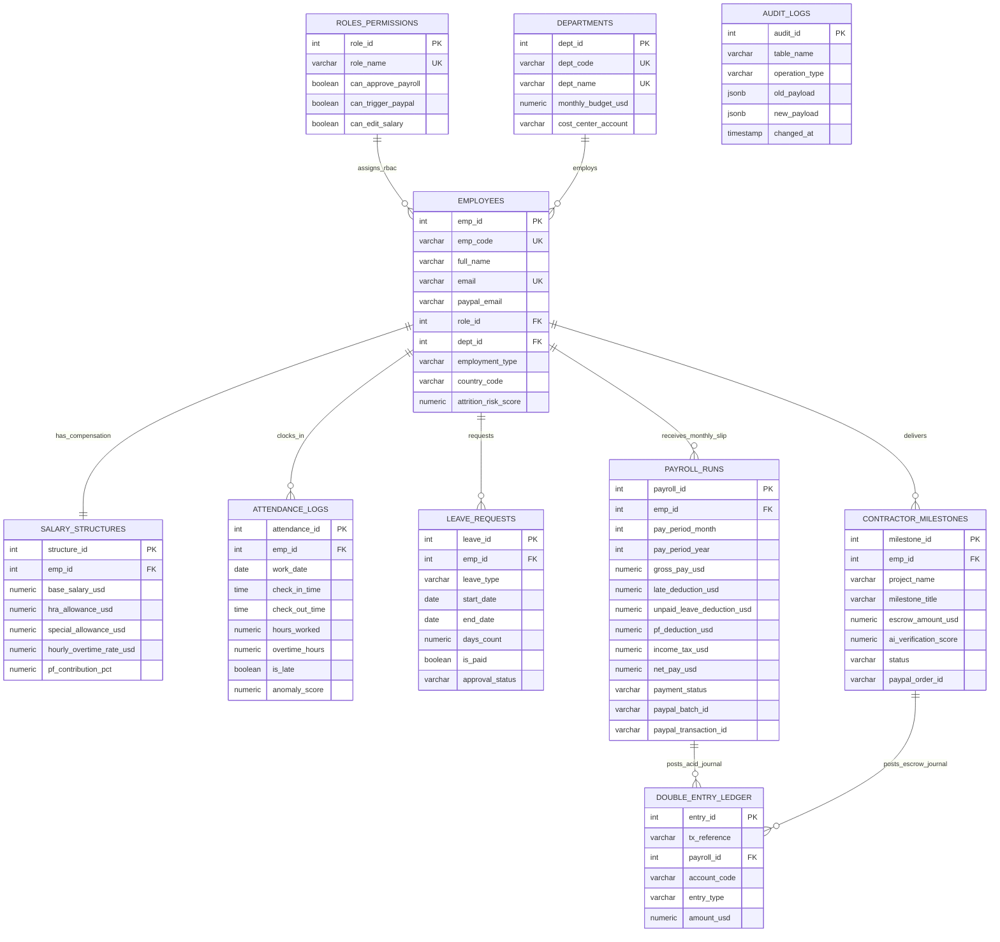

# 📘 Veltriva AI — DBMS Capstone Report & Devpost Hackathon Guide

This document contains:
1. **Your Complete DBMS Capstone Project Documentation (`ETCCMS304` — Experiment 5: Employee Payroll & Attendance Management System)** including the **ER Diagram** (`Mermaid` + `dbdiagram.io` code), **Normalization Proofs (1NF to BCNF)**, and **PL/pgSQL Stored Procedures & Triggers Reference**.
2. **Your Copy-Paste Devpost Submission Guide** for the **PayPal AI Hackathon** + **3-Minute YouTube Demo Video Script**.

---

## PART 1: DBMS Capstone Documentation (`ETCCMS304`)

### 1.1 Entity-Relationship (ER) Diagram (Mermaid)



### 1.2 `dbdiagram.io` Code (Paste directly into https://dbdiagram.io/d for Unit 1 Tool Demo!)

```dbml
Table roles_permissions {
  role_id int [pk, increment]
  role_name varchar [unique, not null]
  can_approve_payroll boolean
  can_trigger_paypal boolean
  can_edit_salary boolean
}

Table departments {
  dept_id int [pk, increment]
  dept_code varchar [unique, not null]
  dept_name varchar [unique, not null]
  monthly_budget_usd numeric
  cost_center_account varchar
}

Table employees {
  emp_id int [pk, increment]
  emp_code varchar [unique, not null]
  full_name varchar [not null]
  email varchar [unique, not null]
  paypal_email varchar [not null]
  role_id int [ref: > roles_permissions.role_id]
  dept_id int [ref: > departments.dept_id]
  designation varchar
  employment_type varchar
  country_code varchar
  attrition_risk_score numeric
}

Table salary_structures {
  structure_id int [pk, increment]
  emp_id int [unique, ref: - employees.emp_id]
  base_salary_usd numeric
  hra_allowance_usd numeric
  special_allowance_usd numeric
  hourly_overtime_rate_usd numeric
  pf_contribution_pct numeric
}

Table attendance_logs {
  attendance_id int [pk, increment]
  emp_id int [ref: > employees.emp_id]
  work_date date
  check_in_time time
  check_out_time time
  hours_worked numeric
  overtime_hours numeric
  is_late boolean
  anomaly_score numeric
}

Table leave_requests {
  leave_id int [pk, increment]
  emp_id int [ref: > employees.emp_id]
  leave_type varchar
  start_date date
  end_date date
  days_count numeric
  is_paid boolean
  approval_status varchar
}

Table payroll_runs {
  payroll_id int [pk, increment]
  emp_id int [ref: > employees.emp_id]
  pay_period_month int
  pay_period_year int
  gross_pay_usd numeric
  late_deduction_usd numeric
  unpaid_leave_deduction_usd numeric
  pf_deduction_usd numeric
  income_tax_usd numeric
  net_pay_usd numeric
  payment_status varchar
  paypal_batch_id varchar
  paypal_transaction_id varchar
}

Table double_entry_ledger {
  entry_id int [pk, increment]
  tx_reference varchar
  payroll_id int [ref: > payroll_runs.payroll_id]
  account_code varchar
  entry_type varchar
  amount_usd numeric
}
```

---

## PART 2: Devpost Submission Copy-Paste Package (PayPal AI Hackathon)

### 🎯 Project Title
**Veltriva AI — Autonomous Global Payroll, Milestone Escrow & ACID Treasury powered by PayPal**

### 💡 Elevator Pitch (Tagline)
An AI-native global workforce treasury that audits shift attendance & contractor milestones, enforces PostgreSQL double-entry ACID locks, and autonomously settles multi-country payroll & escrows via PayPal Payouts and Orders v2 APIs.

### 📖 Inspiration
Global startups and DAO-like teams hire across 10+ countries, but running monthly payroll and releasing contractor milestone payments is still broken:
1. **Manual Timesheet & Milestone Verification:** CFOs waste days cross-checking attendance logs, overtime spikes, late marks, unpaid leaves, and GitHub deliverables before paying staff.
2. **Fear of Agentic Payment Errors:** Letting an AI agent trigger PayPal payouts without strict database concurrency control risks race conditions, double-payouts, or unbalanced accounting ledgers.

We built **Veltriva AI** to fuse **Agentic AI + Machine Learning** with **PayPal Payouts & Orders v2 APIs**, governed by a **3NF/BCNF PostgreSQL 16 Double-Entry ACID Ledger**, **AG Grid**, **Bryntum Gantt/Scheduler**, and **APIMatic Context**.

### 🛠️ How We Built It (PayPal + AI + Partner Stack)
1. **PayPal Developer Platform (Sandbox v1 & v2):**
   - **PayPal Payouts API (`POST /v1/payments/payouts`):** Disburses batch and single employee net salaries globally after statutory tax, PF, and attendance deductions.
   - **PayPal Orders v2 (`POST /v2/checkout/orders`):** Manages contractor milestone escrows with instant capture when our AI agent verifies deliverable completion.
2. **APIMatic Context Validation:**
   - Validates all outbound PayPal payloads against `PayPal-Payouts-v1-OpenAPI-3.1` schemas with idempotency (`PayPal-Request-Id`) headers.
3. **AG Grid Enterprise CFO Command Center:**
   - Renders the live workforce compensation ledger with multi-row selection for batch PayPal settlements, custom status badges, quick filtering, and 1-click CSV export.
4. **Bryntum Gantt & Shift Attendance Scheduler:**
   - Visualizes contractor project milestones, dependencies, shift schedules, and 1-click PayPal escrow capture.
5. **PostgreSQL 16 ACID Engine + PL/pgSQL Triggers:**
   - Uses `BEGIN ... SAVEPOINT ... SELECT FOR UPDATE ... COMMIT` pessimistic locking so two admins or AI agents can never double-pay the same payroll run.
   - Fires `trg_payroll_double_entry_and_audit` on every PayPal settlement to maintain a 100% balanced Double-Entry General Ledger ($\sum \text{Debits} = \sum \text{Credits}$).

---

## 🎬 3-Minute YouTube Demo Video Script (For "Best Demo Delivery" $5,000 Prize)

* **0:00 – 0:25 (The Hook & Live Command Center):**
  * *"Hi Judges! Meet Veltriva AI—an autonomous global payroll, shift attendance, and milestone escrow treasury built on the PayPal Developer Platform, PostgreSQL 16 ACID DBMS, AG Grid, Bryntum, and APIMatic."*
  * Show the **Top KPI Cards** ($108k+ Gross Burn, 4 Settled via PayPal, 6 Pending Settlement, and 100% Balanced Double-Entry Trial Balance).
* **0:25 – 1:10 (AG Grid + 1-Click Batch PayPal Payouts & Salary Slip):**
  * Scroll to the **AG Grid CFO Ledger**. Filter or select rows, click **📄 Slip** on Priya Nair (`VLT-107`) to show the statutory PDF salary slip (highlighting the automatic 0.5-day deduction for 3 late marks and progressive tax).
  * Click **🚀 Settle Pending via PayPal** (or select rows and click **💳 Disburse Selected via PayPal**). Show the toast confirmation and inspect the **Live PayPal API & APIMatic Telemetry JSON box** at the bottom right.
* **1:10 – 1:50 (Bryntum Milestone Gantt + Attendance Trigger):**
  * Switch to **Tab 2: Bryntum Gantt, Shifts & Escrow**. Click **🔓 Capture PayPal Escrow** on Milestone M3 (`$2,400.00`).
  * In the **Log Shift Attendance** form below, log a check-in at `09:45 AM` and check-out at `20:30 PM`. Click submit to show how the PostgreSQL trigger (`trg_attendance_auto_metrics`) automatically flags `is_late = TRUE`, calculates overtime, and re-runs the stored procedure!
* **1:50 – 2:25 (AI Treasury Copilot + ML Models):**
  * Switch to **Tab 3: AI Treasury Copilot & ML Models**. Click the prompt chip *"🛡️ Audit Attendance & Late Penalties"*. Show how the AI Copilot grounds its answer in real SQL queries and highlights the Logistic Regression Attrition ($F1 = 0.921$), Linear Regression Burn Forecast ($R^2 = 0.918$), and $k$-Means Clustering metrics.
* **2:25 – 2:55 (Live PostgreSQL 16 Console & RBAC Security):**
  * Switch to **Tab 4: DBMS Capstone Lab**. Click preset buttons for **Window Functions**, **CTEs**, **Double-Entry Trial Balance**, and **`EXPLAIN ANALYZE`**.
  * Finally, switch the top **🔐 RBAC Role** dropdown to `FULL_TIME_STAFF` and show how unauthorized PayPal payout clicks are blocked by JWT + PostgreSQL RBAC!
